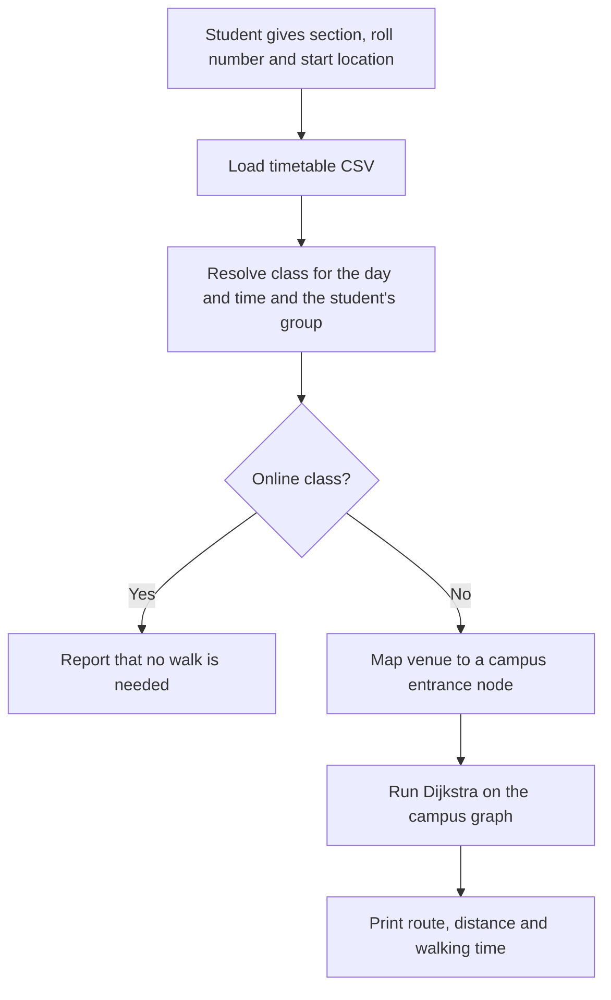

<div align="center">

# 🧭 Sted: A College Navigation System

**Timetable-aware, shortest-path walking navigation for a college campus.**

</div>

Sted has **two independent implementations** that share the same campus data: a **static website** (interactive map, GPS walking directions, timetable, and a rooms directory) and a **standalone C++ terminal program** (campus graph, Dijkstra shortest path, and an object-oriented timetable engine). The website and the terminal program do not call each other.

---

## 📑 Table of Contents

1. [Description](#-description)
2. [Problem Statement](#-problem-statement)
3. [Objectives](#-objectives)
4. [Key Features](#-key-features)
5. [The Two Implementations](#-the-two-implementations)
6. [How It Works](#-how-it-works)
7. [Tech Stack](#-tech-stack)
8. [Project Structure](#-project-structure)
9. [Data Files](#-data-files)
10. [Getting Started](#-getting-started)
11. [Usage](#-usage)
12. [Known Limitations](#-known-limitations)
13. [Future Scope](#-future-scope)
14. [Credits](#-credits)
15. [References](#-references)

---

## 📌 Description

Students and faculty often struggle to reach their next lecture on time when classrooms are located across different campus blocks. Existing timetable systems tell users **what** class and room they are scheduled for, but they don't help with actually **navigating** there.

**Sted** closes that gap by combining a static timetable with shortest-path campus navigation. Given a user's current location, Sted:

1. Finds their **next lecture** from the timetable.
2. Maps the lecture's classroom to the nearest campus entrance.
3. Computes the **shortest walking route** to it.

The timetable in Sted is **static**: it is stored in a fixed CSV file and read as it is, so it does not change while the system is running.

---

## ❗ Problem Statement

- **Spread-out campuses:** classrooms sit in different blocks, so a wrong turn can mean arriving late.
- **A gap between timetable and navigation:** a timetable says *where* to go, but not *how* to get there.

---

## 🎯 Objectives

- Model the campus as a **weighted graph** (locations and junctions as nodes, walkable paths as edges measured in metres).
- Find the **shortest walking route** between any two locations.
- Resolve a student's **current or next class** from the timetable, based on the day, time, and their group (G1/G2).
- Use a **static timetable** stored in a CSV file as the single source of class timings and venues.
- Offer a **user-friendly website** and a **terminal program** that demonstrates the underlying data structures, algorithms, and object-oriented design.

---

## ✨ Key Features

### 🌐 Website

| Feature | What it does |
|---|---|
| 🗺️ **Interactive campus map** | Leaflet map on OpenStreetMap tiles with a marker for every mapped campus location; hover for the name, click to pick a start or destination. |
| 🚶 **Route planner** | Pick a start and a destination to get the walking time, distance, the next stop, and step-by-step directions with turn icons and distances. |
| 🧭 **Snapped to mapped paths** | Routes follow mapped walking paths; the page tells you how far your start and destination were moved onto a path. |
| 📍 **Live GPS mode** | "Use my location" tracks the user with the browser's high-accuracy location, shows latitude, longitude, and accuracy, and updates the route as they move. |
| 🔄 **Heading-up map** | While walking, the map rotates so that the direction of travel points up. |
| 🔔 **Turn alerts** | When the user comes within 25 m of an upcoming turn, the status line announces it and the phone vibrates (where supported). |
| ⏭️ **Next Class Route** | One click finds the next class from today's timetable, sets its venue as the destination, and starts GPS if no start point is chosen. |
| 📅 **Static timetable view** | Section A, Semester III, Group 1 timetable with a day filter that opens on today's day. |
| 🏢 **Rooms directory** | Search rooms and facilities, filter by building and floor, and press ↗ on a room to route to it. |
| 🕒 **Live clock** | Shows the current time and date in India (IST). |
| 🎛️ **Map controls** | Buttons to return to the campus view (⌂), reset the destination (↺), jump to your location (◎), and a Route overview button. |

### 💻 Terminal Program

| Feature | What it does |
|---|---|
| 🧮 **Dijkstra shortest path** | Computes the shortest route on the campus graph using a priority queue. |
| ⏱️ **Walking time estimate** | Converts the distance into minutes using a walking speed of 75 m/min. |
| 🎓 **Class-aware routing** | Resolves the class for a section, semester, and roll number at the current or a chosen time, then routes to it. |
| 👥 **G1/G2 groups** | Works out a student's group from their roll number and the last roll number in G1. |
| 💻 **Online classes** | Detects classes held online and skips the walking route. |
| 📦 **Self-contained executable** | CSV data is embedded at build time, so the program runs without the repository or a data folder. |
| ⚙️ **Command-line shortcuts** | Scriptable flags such as `--route`, `--timetable-route`, and `--places`. |

---

## 🧩 The Two Implementations

### 🌐 1. Static Website (`index.html`, `script.js`, `style.css`)

- Pure front end: no backend or build step. It reads the CSV files in `data/` directly in the browser and parses them with **Papa Parse**.
- Uses **Leaflet** (with the **leaflet-rotate** plugin) for the map and the **OpenStreetMap foot-routing service** to calculate walking routes between coordinates.
- Combines the route planner, GPS tracking, timetable, and rooms directory in one page.

#### What `script.js` does

| Area | How it works |
|---|---|
| **Data loading** | On start, it loads the campus coordinates and the five building room lists, then the timetable and the venue mapping. Every file is validated (for example duplicate node IDs, missing coordinates, unknown navigation nodes), and a clear error message is shown if a file is broken. |
| **Route planning** | `updateRoute()` sends the start and destination coordinates to the walking-route service and gets back the path, distance, duration, and turn-by-turn steps. A newer request cancels an older one, so slow responses never overwrite a fresh route. |
| **Directions** | Each step is shown with an arrow icon (↰ ↱ ↑ and so on), a plain-English instruction such as "Turn left", the path name, and its distance. The final step reads "Arrive at …". |
| **GPS tracking** | `startGPS()` watches the user's position. The route is recalculated once the user has moved at least 15 m from the last routed point. If location permission fails, the page falls back to the start point chosen in the list. |
| **Heading-up map** | When the user moves faster than 0.8 m/s, the map rotates to the direction of travel (updates are limited to every 150 ms to keep it smooth). Stopping GPS restores north-up. |
| **Turn alerts** | Turn points are taken from the route steps. When the user is within 25 m of the next one, it is announced once and the phone vibrates. |
| **Distance calculation** | Distances between two GPS points are calculated with the haversine formula. |
| **Timetable** | `loadTimetable()` keeps only Section A, Semester III records for Group 1 or both groups, checks that each record is complete, and sorts them by day and time. The day filter opens on today's day in IST. |
| **Next Class Route** | `findUpcomingClass()` picks the first class today that starts at or after the current time (IST). Online classes need no route; other venues are looked up in `timetable_venue_nodes.csv` to find the entrance to walk to, and its indoor route note is shown. |
| **Rooms directory** | Rooms from all five buildings are combined into one searchable list. The search looks across building, floor, room, name, and notes. Pressing ↗ routes to the room's mapped node, to a campus location with a matching name, or else to the building's main entrance. |
| **Map behaviour** | Campus markers fade while a route is active. If you drag or zoom the map while no route is active, it returns to the full campus view after 10 seconds. The page also has smooth section scrolling and browser back-button support. |

### 💻 2. C++ Terminal Program (`main.cpp`, `TimeTable/`)

- Written in **C++11** and built with **CMake** into one executable named `sted_graph`.
- Implements its **own routing**: the campus graph and Dijkstra's algorithm live in `main.cpp`.
- The `TimeTable/` folder holds the object-oriented timetable engine (see below).

#### Object-oriented design (`TimeTable/`)

| Class | Role |
|---|---|
| `TimeSlot` | A block of time on a day; provides `overlaps()` for clash detection. |
| `Venue` | A classroom or lab name. |
| `Subject` (abstract) → `TheorySubject`, `PracticalSubject` | A course, with polymorphic `describe()`. |
| `ScheduleEntry` | One recurring class: slot, subject, venue, and group scope (G1, G2, or both). |
| `Timetable` | Holds the entries of a section and semester and answers "what class is at this time?". |
| `Section` | A class section; resolves a roll number to its G1/G2 group. |
| `User` (abstract) → `Admin`, `Student` | The admin loads the timetable entries; students are read-only and have a G1/G2 group. |
| `SystemClock` / `LiveClassResolver` | Reads the current day and time, and resolves "what class is happening now" for a student. |

---

## ⚙️ How It Works



**In plain English:**

1. **The campus is a graph.** Each named place (a block entrance, a hostel, a ground) is a node. Walkable connections between places are edges, each with a length in metres. Bends in roads are stored as extra "junction" nodes.
2. **The timetable is a static CSV file.** Each row says which class happens in which room, on which day, at what time, and for which group. It is read as it is and is not changed while the program runs.
3. **Venues are mapped to entrances.** A small file links each classroom name (for example `LT-5`) to the campus node of the building entrance, plus a note on where to go indoors.
4. **Dijkstra finds the shortest path.** Starting from the user's location, the program always expands the closest unvisited node first until it reaches the destination, so the first time it arrives is guaranteed to be the shortest route.

**On the website**, the same idea applies, with these differences:

1. The walking route between two coordinates is calculated by the **OpenStreetMap foot-routing service**, not by the Dijkstra code in the C++ program.
2. The start point can be a campus location or the user's **live GPS position**, which is snapped to the nearest mapped path.
3. The timetable's "next class" is the first class today that starts at or after the current time (in IST).
4. While the user walks, the route is refreshed every 15 m and upcoming turns trigger alerts.

---

## 🛠️ Tech Stack

| Part | Technologies |
|---|---|
| **Terminal program** | C++11, STL (`priority_queue`, `vector`, `unordered_map`, `map`), CMake 3.16+ |
| **Website** | HTML5, CSS3, JavaScript (ES6+, `fetch`, `async/await`), [Leaflet](https://leafletjs.com/) 1.9.4, leaflet-rotate, [Papa Parse](https://www.papaparse.com/) 5.4.1 |
| **Map and routing** | OpenStreetMap tiles, OpenStreetMap foot-routing service, browser Geolocation and Vibration APIs |
| **Data** | CSV files (campus graph, timetable, venue mapping, room directories) |
| **Local preview** | Python's built-in `http.server` |

---

## 📂 Project Structure

```text
STED-A_College_Navigation_System/
├── CMakeLists.txt          # Builds sted_graph and embeds the CSV data
├── EmbeddedData.h          # Declares embeddedCsv(): lookup of the embedded CSVs
├── main.cpp                # Campus graph, Dijkstra, CSV loading, menu and CLI
├── TimeTable/              # Object-oriented timetable engine
│   ├── Core.h / Core.cpp                  # TimeSlot, Venue, Subject, TheorySubject, PracticalSubject
│   ├── ScheduleEntry.h / .cpp             # ScheduleEntry (one class in the timetable)
│   ├── Timetable.h / .cpp                 # Timetable
│   ├── Section.h / .cpp                   # Section and G1/G2 resolution
│   ├── User.h / .cpp                      # User, Admin, Student
│   └── LiveClock.h / .cpp                 # SystemClock and LiveClassResolver
├── index.html              # Website page and map setup
├── script.js               # Website logic: routing, GPS, timetable, directory
├── style.css               # Website styling
├── data/
│   ├── node_coordinates.csv       # Named campus locations with latitude and longitude
│   ├── campus_edges.csv           # Walkable connections and their lengths in metres
│   ├── timetable_examples.csv     # Timetable records
│   ├── timetable_venue_nodes.csv  # Maps each classroom to a campus entrance node
│   ├── BTECH.csv, CSIT.csv, KP Nautiyal.csv, Mechanical.csv, Paramedical.csv  # Room directories
│   └── Indoors/                   # Indoor reference photos (library, lab, B.Tech block)
├── .gitignore
└── README.md
```

---

## 🗃️ Data Files

| File | Contents |
|---|---|
| `node_coordinates.csv` | About 80 named campus locations: ID, name, latitude, longitude. |
| `campus_edges.csv` | About 390 walkable connections between locations and road junctions: from, to, length in metres, edge type (`road_chain`, `direct`, `outside_road`). |
| `timetable_examples.csv` | Class records: section, semester, day, start and end time, course code, subject, faculty, theory or practical, venue, and group scope. |
| `timetable_venue_nodes.csv` | Classroom name → campus entrance node, with a route note for finding the room indoors. |
| `BTECH.csv`, `CSIT.csv`, `KP Nautiyal.csv`, `Mechanical.csv`, `Paramedical.csv` | Room and facility lists by building and floor, used by the website's rooms directory. `BTECH.csv` has no header row and includes a side and a navigation node for each room; the others have a header row. |

---

## 🚀 Getting Started

### Prerequisites

- **Terminal program:** CMake 3.16 or newer and a C++11 compiler (GCC, Clang, or MSVC).
- **Website:** Python 3 (only to run the local preview server), a modern browser, and an **internet connection** (the map tiles, Leaflet, and the walking-route service are loaded online).

### Clone the repository

```bash
git clone https://github.com/KryptoAnuj/STED-A_College_Navigation_System.git
cd STED-A_College_Navigation_System
```

### 💻 Build and run the terminal program

Build from the repository root with CMake and a C++ compiler. CMake compiles all C++ modules into one executable and embeds the graph and timetable CSV data, so the built executable runs without the repository or a separate data folder.

```bash
cmake -S . -B build/cpp
cmake --build build/cpp --config Release
```

| Setup | Run command |
|---|---|
| Windows, multi-configuration generator | `build\cpp\Release\sted_graph.exe` |
| Windows, single-configuration generator | `build\cpp\sted_graph.exe` |
| Linux / macOS | `./build/cpp/sted_graph` |

### 🌐 Preview the website

The website loads its own static files and building directories from the repository. From the repository root, run:

```bash
python -m http.server 8000 --bind 127.0.0.1
```

Open **http://127.0.0.1:8000** in your browser. (Opening `index.html` by double-clicking will not work, because the page loads the CSV files with `fetch`, which needs a server.)

---

## 📖 Usage

### Website

1. **Plan a route:** choose a start and a destination from the lists (or click markers on the map: the first click sets the start, the next clicks set the destination), then click **Find shortest walking route**. The map draws the path and lists the steps.
2. **Use GPS:** click **Use my location** to start from where you are. Allow location access when the browser asks. Click **Stop GPS** to end tracking.
3. **Next Class Route:** click the button in the top section to route to your next class today. If you haven't chosen a start point, GPS starts automatically.
4. **Route overview:** click the button above the map to zoom out to the whole route.
5. **Map buttons:** ⌂ returns to the campus view, ↺ clears the destination, and ◎ centres the map on your location.
6. **Timetable:** open the Schedule section and use **Show day** to filter by day.
7. **Rooms directory:** search for a room or facility, filter by building and floor, and press ↗ to route to it.

> Location access works on `localhost` and on HTTPS pages, which is why the preview server above is enough.

### Terminal program

Run it with no arguments to open the interactive menu:

```text
========================================
  STED Campus Timetable & Route Planner
========================================
1. Find my class and walking route now
2. Find my class and walking route at a chosen time
3. View a section's weekly timetable
4. Find a walking route between campus locations
5. List campus locations and IDs
0. Exit
```

**Command-line shortcuts**

```bash
# List all campus locations and their IDs
sted_graph --places

# Shortest route between two locations
sted_graph --route <start-id> <destination-id>

# Route to a student's class right now
sted_graph --timetable-route <section> <semester> <roll-number> <g1-cutoff> <start-id> --now

# Route to a student's class at a chosen time
sted_graph --timetable-route <section> <semester> <roll-number> <g1-cutoff> <start-id> <DAY> <HH:MM> <YYYY-MM-DD>

# Show help
sted_graph --help
```

Here `<g1-cutoff>` is the last roll number that belongs to Group 1; higher roll numbers are in Group 2.

---

## ⚠️ Known Limitations

- The timetable data currently covers **Section A, Semester III** only.
- Venue-to-entrance mappings exist for a limited set of classrooms; rooms without a mapping cannot be routed to.
- The timetable is **static**: it is read from a CSV file and does not update by itself. To change the schedule, edit `data/timetable_examples.csv` (the terminal program must be rebuilt, because the CSV is embedded in it).
- The website needs an internet connection for map tiles, the Leaflet and Papa Parse libraries, and walking routes, and GPS accuracy depends on the user's device.
- Website routes come from the OpenStreetMap foot-routing service, so they follow the paths that exist in OpenStreetMap, and start points are snapped to the nearest one.
- The website timetable shows Group 1 and shared classes of Section A, Semester III only.
- Rooms in the directory that have no mapped navigation node are routed to the building's main entrance.
- Vibration alerts depend on the device and browser supporting the Vibration API.
- Indoor navigation is not implemented; routes end at the building entrance, with a text note for finding the room.

---

## 🔮 Future Scope

- Add timetables for all sections and semesters, and map every classroom to its entrance.
- Add indoor floor-wise navigation inside each building.
- Offer accessibility-friendly routes, such as paths without stairs.
- Connect the website to the C++ routing and timetable logic through one shared backend.
- Let students sign in and see their own timetable automatically.

---

## 🙏 Credits

| Name | Role | GitHub |
|---|---|---|
| Anuj Agarwal | Leader | [@KryptoAnuj](https://github.com/KryptoAnuj) |
| Atharv Kamboj | Developer | [@atharv229](https://github.com/atharv229) |
| Ayush Bhalla | DB/Testing | [@Aayush-Bhalla](https://github.com/Aayush-Bhalla) |
| Parth Raj Jaiswal | Developer/Docs | [@ParthJaiswal-md](https://github.com/ParthJaiswal-md) |

---

## 📑 References

- [IEEE Xplore: related navigation systems research](https://ieeexplore.ieee.org/document/10001791)
- [Evelity Blog: Students Getting Lost on Campus (2025 Survey)](https://blog.evelity.com/en/students-getting-lost-on-campus-2025-survey)
- [MazeMap: Hidden Drivers of Student Retention](https://www.mazemap.com/post/hidden-drivers-of-student-retention)
- [Leaflet](https://leafletjs.com/) and [OpenStreetMap](https://www.openstreetmap.org/) for the interactive map and routing
